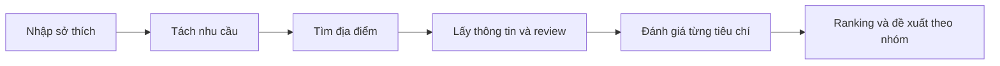

# DaLat TravelMate Agent

**Tìm một nơi hợp với bạn.**

AI Agent đề xuất địa điểm **ăn uống, cà phê và tham quan tại Đà Lạt** từ sở thích viết bằng tiếng Việt. Agent tìm địa điểm thực tế, phân tích thông tin/review và trả đề xuất theo từng nhóm nhu cầu.

Mỗi địa điểm có ảnh khi có dữ liệu, tên, Google Rating, số đánh giá, địa chỉ, lý do đề xuất và link Google Maps. Đã có workflow Python, FastAPI, Streamlit và Docker Compose chạy local.

## Demo

<details>
<summary>Tìm quán bánh ngọt có cảnh đẹp</summary>


</details>

<details>
<summary>Tìm cà phê mát mẻ, phù hợp đọc sách</summary>


</details>

Ảnh chụp các lần chạy thực tế; kết quả và rating có thể thay đổi. Thông tin thiếu không được xem là đã xác minh.

## Công nghệ và cách hoạt động

**Python · LangGraph · LangChain · DeepSeek API · SerpApi Google Maps · FastAPI · Streamlit · Docker Compose**



- **LangGraph** điều phối workflow; **DeepSeek qua LangChain** tách nhu cầu và đối chiếu tiêu chí với bằng chứng.
- **SerpApi** cung cấp Search, Details và Reviews. **Python** chuẩn hóa, kiểm tra kết quả, ranking và tạo lý do bằng mẫu câu.
- **Streamlit** gửi yêu cầu tới **FastAPI**, nhận kết quả để hiển thị. **Docker Compose** chạy hai thành phần cùng nhau.

Ranking cộng 1 cho bằng chứng thuận, trừ 1 cho bất lợi; mixed/unknown cho 0. Hòa điểm xét Google Rating rồi giữ thứ tự Search. Chọn Top-K riêng mỗi nhóm trong tập ứng viên đã đánh giá; không coi rating là bằng chứng đáp ứng sở thích.

## Chạy ứng dụng

### 1. Lấy code và tạo cấu hình

Cách dưới đây dùng terminal Bash. Máy cần Docker, Docker Compose và Internet; không cần cài Python/Conda nếu chạy bằng Docker.

```bash
git clone https://github.com/nhannhan2201/DaLat_TravelMate_Agent.git
cd DaLat_TravelMate_Agent
cp -n .env.example .env
```

Nếu đã có repo, vào thư mục dự án và giữ `.env` hiện có. Điền **bốn biến bắt buộc** trong `.env` bằng thông tin tài khoản của bạn:

```dotenv
DEEPSEEK_API_KEY=<key nhà cung cấp mô hình>
DEEPSEEK_BASE_URL=https://api.vilao.ai/v1
DEEPSEEK_MODEL=chib/deepseek-v4.1-flash
SERPAPI_API_KEY=<key SerpApi>
```

Endpoint/model trên là cấu hình Vilao đã chạy thử trong dự án; key, endpoint và model phải tương ứng với dịch vụ bạn dùng. Các biến còn lại trong `.env.example` có thể để trống để dùng mặc định. Không commit `.env`; các lần tìm kiếm sử dụng hạn mức/phí API của bạn.

### 2. Khởi động

Đảm bảo Docker đang chạy, rồi thực hiện:

```bash
docker compose up --build
```

Mở **[http://127.0.0.1:8501](http://127.0.0.1:8501)**, nhập sở thích và nhấn **Tìm nơi dành cho bạn**. Không cần mở hai terminal chạy FastAPI/Streamlit riêng.

Image đã có và code chưa thay đổi thì lần sau chỉ cần `docker compose up`. Nếu cổng mặc định bị chiếm, dùng:

```bash
BACKEND_PORT=8001 FRONTEND_PORT=8502 docker compose up --build
```

Khi đó giao diện ở `http://127.0.0.1:8502`. UI mặc định xem xét tối đa 10 ứng viên và hiển thị Top 2 **mỗi nhóm**; có thể đổi trong “Tùy chọn kết quả”.

### 3. Dừng

Nhấn **Ctrl+C**, sau đó:

```bash
docker compose down
```

<details>
<summary>Chạy bằng Python khi phát triển, không dùng Docker</summary>

Đã chạy thử với Python 3.12. Chuẩn bị `.env` như trên, rồi cài môi trường tại thư mục gốc repo:

```bash
conda create -n dalat-travelmate python=3.12
conda activate dalat-travelmate
python -m pip install -r requirements.txt
```

Nếu môi trường đã có thì chỉ cần activate và cài dependencies. Giữ cả hai terminal sau chạy:

**Terminal 1 — backend:**

```bash
conda activate dalat-travelmate
python -m uvicorn app.main:app --host 127.0.0.1 --port 8000 --reload
```

**Terminal 2 — frontend, cũng tại thư mục gốc repo:**

```bash
conda activate dalat-travelmate
python -m streamlit run ui/app.py --server.address 127.0.0.1 --server.port 8501
```

Mở `http://127.0.0.1:8501`. API docs ở `http://127.0.0.1:8000/docs`. Nhấn Ctrl+C ở cả hai terminal để dừng.

</details>

## Đánh giá

Bộ 10 câu có một/nhiều nhu cầu và tiêu chí khó xác minh. Chỉ chấm **hiểu nhu cầu** và **bám nguồn của từng đánh giá tiêu chí**; không chấm lời giải thích trên UI hoặc lấy điểm ranking làm nhãn chất lượng. unknown có thể là kết quả đúng khi thiếu thông tin.

### 10 câu đã đánh giá và kết quả

Lần chạy ngày **18/10/2026**, model `chib/deepseek-v4.1-flash`, tối đa **3 ứng viên/nhóm**, **Top 2/nhóm**. Người dùng đã chốt cả 10 câu giữ được ý chính, đúng nhóm và phân biệt wants/avoids. Cột bám nguồn ghi số **Đạt / Chưa đạt** theo từng tiêu chí của từng địa điểm, không phải số quán.

| Mã | Câu người dùng nhập | Hiểu nhu cầu | Bám nguồn — sơ bộ |
|---|---|---|---:|
| E01 | Tôi muốn tìm chỗ ăn vặt. | Đạt | 1 / 2 |
| E02 | Tôi muốn tìm tiệm bánh ngọt có chỗ ngồi lại và phục vụ trà. | Đạt | 6 / 0 |
| E03 | Tôi muốn ăn bánh căn vào buổi sáng, tránh chỗ ngồi sát đường nhiều khói xe. | Đạt | 12 / 0 |
| E04 | Tôi muốn tìm quán nướng có chỗ ngồi ngoài trời và nhìn ra đồi núi. | Đạt | 6 / 0 |
| E05 | Tôi muốn tìm nơi ngắm hoàng hôn, không phải đi bộ lên dốc nhiều. | Đạt | 3 / 0 |
| E06 | Tôi muốn tham quan vườn hoa có lối đi dễ di chuyển cho người lớn tuổi. | Đạt | 6 / 0 |
| E07 | Tôi muốn tìm nơi nghe nhạc acoustic vào buổi tối, có chỗ ngồi. | Đạt | 5 / 1 |
| E08 | Tôi muốn quán cà phê có nhiều cây xanh, yên tĩnh để đọc sách. | Đạt | 8 / 1 |
| E09 | Tôi muốn tìm chỗ ăn vặt giá hợp lý và tiệm bánh có chỗ ngồi ngoài trời. | Đạt | 12 / 0 |
| E10 | Tôi muốn quán ăn có món chay, quán cà phê ven hồ và một nơi ngắm cảnh đồi núi. | Đạt | 8 / 1 |

**Tổng:** hiểu nhu cầu **10 Đạt / 0 Chưa đạt**; bám nguồn sơ bộ **67 Đạt / 5 Chưa đạt / 0 Chưa xác định**, trên 72 đánh giá tiêu chí của 36 lượt địa điểm. Một ứng viên E07 lỗi assessment được ghi riêng, không chấm như lỗi phân tích.

**Tình trạng duyệt:** người dùng đã duyệt 7 mục bám nguồn từng mơ hồ (6 Đạt, 1 Chưa đạt). 61 Đạt và 4 Chưa đạt còn lại là nhận xét trợ lý, chưa duyệt toàn bộ. Các vấn đề ghi nhận gồm gán nguồn phản bác sai và trả unknown quá bảo thủ. Đây là bộ nhỏ có trợ lý hỗ trợ, **không phải accuracy toàn hệ thống**.

[Bộ câu hỏi](evaluation/cases.json) · [Cách chạy đánh giá, test offline và hướng dẫn chấm](evaluation/README.md). Runner không tự chấm; dữ liệu nguồn/nhận xét được giữ local trong `evaluation/runs/` và không được push. Hiện có 13 test runner offline; chưa có bộ unit test ranking/assessment riêng.

## Cấu trúc chính

```text
app/          Workflow, schemas, clients, ranking và FastAPI
ui/           Giao diện Streamlit
.streamlit/   Theme
evaluation/  Bộ câu hỏi, runner và hướng dẫn đánh giá
tests/       Test runner offline
docs/images/ Bốn ảnh demo
Dockerfile
compose.yaml
.env.example
requirements.txt
```

## Giới hạn

- Chỉ hỗ trợ Đà Lạt; không làm lịch trình, khách sạn, đặt phòng hoặc tối ưu đường đi.
- Reviews mới lấy trang đầu; nhiều tiêu chí có thể chưa đủ bằng chứng. ID nguồn hợp lệ chưa bảo đảm LLM kết luận đúng nghĩa.
- Top-K chỉ trong tập ứng viên đã đánh giá. Query và tâm bản đồ chưa bảo đảm mọi địa điểm đúng khu vực hoặc đáp ứng sở thích.
- Ảnh và dữ liệu có thể thiếu/thay đổi. Search mới chuẩn hóa `local_results`; ứng dụng hiện phục vụ local, chưa có xác thực hay giới hạn tần suất cho triển khai public.
