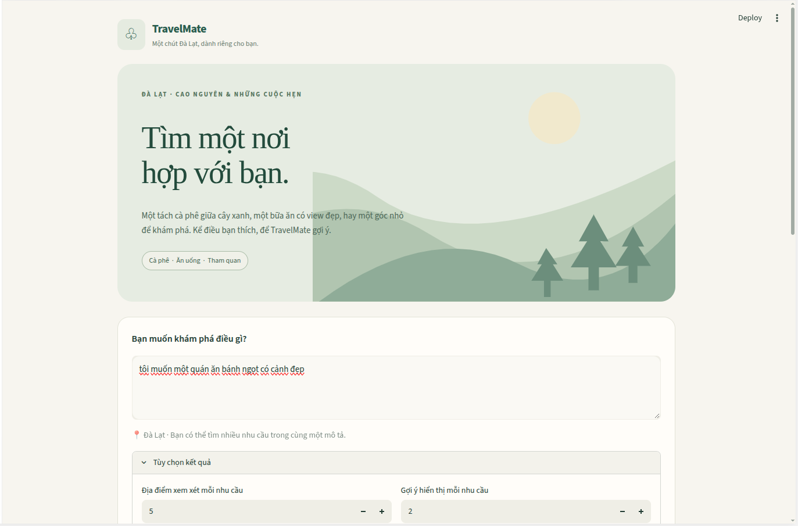
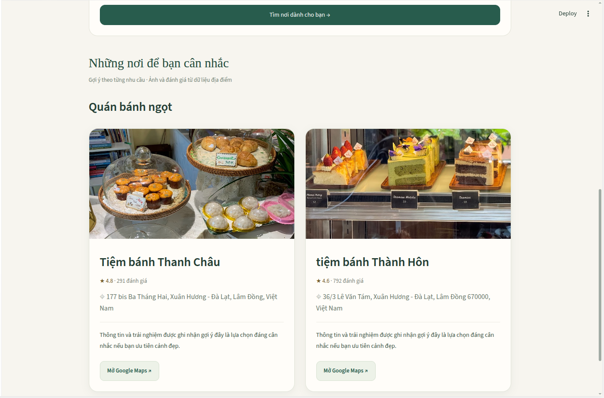
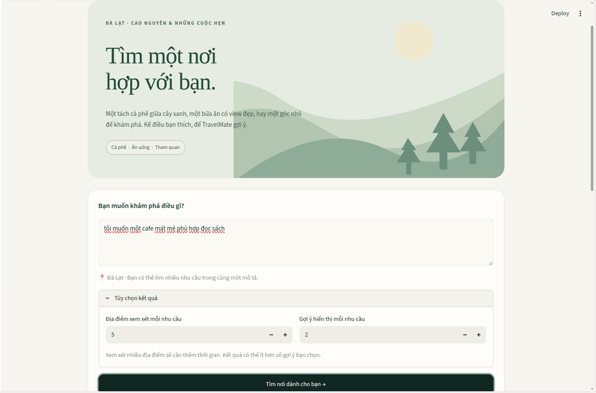
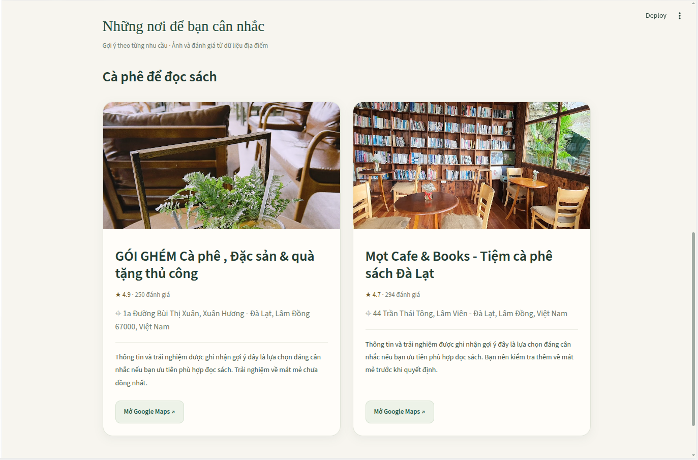
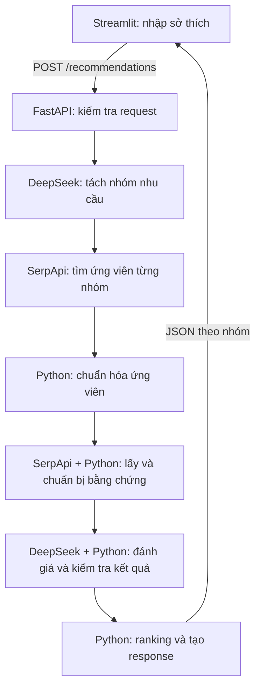

# DaLat TravelMate Agent

**Tìm một nơi hợp với bạn.**

AI Agent đề xuất địa điểm ăn uống, cà phê và tham quan tại Đà Lạt từ mô tả sở thích bằng tiếng Việt. Ứng dụng tìm địa điểm thực tế qua SerpApi Google Maps, đối chiếu thông tin/review với nhu cầu bằng DeepSeek và trả đề xuất theo từng nhóm.

**Trạng thái:** đã có workflow Python, FastAPI và Streamlit chạy local. Đã có cấu hình Docker Compose để chạy hai service.

## Bắt đầu nhanh — Docker

Cần **Docker có Compose**, Docker daemon hoạt động, Internet và tài khoản API có hạn mức. Không cần cài Python hoặc Conda trên máy khi dùng cách này.

1. Lấy repository về bằng Git hoặc tải ZIP, rồi mở terminal tại thư mục gốc.
2. Tạo cấu hình riêng nếu chưa có:

   ```bash
   cp -n .env.example .env
   ```

3. Điền `DEEPSEEK_API_KEY`, `DEEPSEEK_BASE_URL`, `DEEPSEEK_MODEL` và `SERPAPI_API_KEY` trong `.env`. Xem [cấu hình](#cài-đặt) bên dưới.
4. Build và khởi động:

   ```bash
   docker compose up --build
   ```

5. Mở [giao diện](http://127.0.0.1:8501), nhập sở thích và nhấn **Tìm nơi dành cho bạn**.

Dừng bằng Ctrl+C; chạy `docker compose down` để dọn container và mạng dự án. Không cần chạy `docker build` riêng hoặc có image trên Docker Hub: Compose build image từ source trong repo.

## Nội dung

- [Demo giao diện](#demo-giao-diện)
- [Phạm vi MVP](#phạm-vi-mvp)
- [Công nghệ](#công-nghệ-và-vai-trò)
- [Kiến trúc, bằng chứng và ranking](#kiến-trúc-và-workflow)
- [Cấu trúc repository](#cấu-trúc-repository)
- [Cài đặt và cấu hình](#cài-đặt)
- [Chạy bằng Python](#chạy-ứng-dụng)
- [Chạy bằng Docker Compose](#chạy-bằng-docker-compose)
- [API](#api)
- [Kiểm tra](#kiểm-tra-kết-quả)
- [Xử lý lỗi thường gặp](#xử-lý-lỗi-thường-gặp)
- [Giới hạn](#giới-hạn-và-bước-tiếp-theo)

## Demo giao diện

Giao diện lấy cảm hứng từ đồi núi và rừng thông Đà Lạt, với tông xanh và nền kem. Mỗi thẻ hiển thị ảnh thực tế khi có, tên, Google Rating, số đánh giá, địa chỉ, lý do đề xuất và nút Google Maps.

### Tìm quán bánh ngọt có cảnh đẹp

**Mô tả:** “Tôi muốn một quán ăn bánh ngọt có cảnh đẹp.”





### Tìm cà phê mát mẻ, phù hợp đọc sách

**Mô tả:** “Tôi muốn một cafe mát mẻ phù hợp đọc sách.”





Các ảnh trên là ảnh chụp lần chạy thực tế do người dùng cung cấp. Tên quán, rating, số đánh giá và thứ tự đề xuất có thể thay đổi ở lần chạy khác; ảnh demo không chứng minh mọi tiêu chí đều được đáp ứng.

## Phạm vi MVP

- Nhận một hoặc nhiều nhu cầu trong cùng mô tả; các tiêu chí của cùng mục đích nằm trong một nhóm.
- Tìm ứng viên, lấy thông tin và một trang review, đánh giá từng tiêu chí rồi chọn Top-K **riêng cho mỗi nhóm**.
- Xử lý dữ liệu thiếu, bằng chứng trái ngược và lỗi riêng từng ứng viên.
- Giữ điểm và ID bằng chứng nội bộ; trả lời ngắn gọn cho người dùng.

MVP chỉ hỗ trợ **Đà Lạt**, nhưng giữ `location` trong dữ liệu để mở rộng sau. Không làm lịch trình theo ngày, khách sạn, đặt phòng hay tối ưu đường đi.

## Công nghệ và vai trò

| Component | Vai trò |
|---|---|
| Python + Pydantic | Kiểu dữ liệu, validation, chuẩn hóa và ranking |
| LangGraph | Truyền state và điều phối các node của Agent |
| LangChain + DeepSeek API | Tách nhu cầu, soạn query và đối chiếu tiêu chí với bằng chứng |
| SerpApi Google Maps | Search, Place Details và Reviews |
| FastAPI + Uvicorn | Nhận HTTP request và trả JSON đề xuất |
| Streamlit | Form nhập sở thích và thẻ kết quả theo nhóm |
| Docker Compose | Build image Python và chạy backend/frontend cùng nhau |

MVP không triển khai dịch vụ LangSmith, pytest, GitHub Actions, Kubernetes, Helm hoặc MCP. Việc kiểm tra hiện thực hiện bằng dữ liệu mẫu và chạy thử thủ công.

## Kiến trúc và workflow



Sơ đồ thể hiện luồng ứng dụng; các bước từ tách nhu cầu đến output chạy trong LangGraph. Nhánh tìm lại bằng query rộng được xử lý **bên trong node Search**, chưa phải conditional edge riêng của graph.

| Bước | Input → Output |
|---|---|
| Extract Needs | `description` → các `NeedGroup` gồm tên nhóm, `wants`, `avoids`, query cụ thể và query rộng |
| Search | Query mỗi nhóm + `location` → phản hồi Maps và query thực sự đã dùng |
| Normalize | `local_results` → `CandidateGroup`, gồm nhu cầu và danh sách `PlaceCandidate` |
| Evidence | Ứng viên được chọn → `PlaceEvidence`, giữ dữ liệu nguồn với ID riêng |
| Assess | Nhu cầu + bằng chứng → `PlaceAssessment`, một đánh giá cho mỗi tiêu chí |
| Ranking / Output | Các `AssessmentGroup` + Top-K → `RecommendationResponse` |

Search thêm tên thành phố và tâm bản đồ Đà Lạt vào request. Nếu query cụ thể không có ứng viên, node thử query rộng khi hai query khác nhau. Việc xuất hiện trong Search chưa chứng minh địa điểm đáp ứng sở thích.

### Bằng chứng và đánh giá

`build_place_evidence()` chọn các trường Details có mặt: `type`, `description`, `extensions`, `hours`. Review có chữ trong `snippet` được giữ cùng ngày và link khi có; bỏ review không có nội dung và ID review trùng. Metadata API không được đưa vào prompt.

DeepSeek đánh giá từng tiêu chí với bốn trạng thái:

| Trạng thái | Ý nghĩa đối với chính tiêu chí |
|---|---|
| `supported` | Có bằng chứng hỗ trợ |
| `contradicted` | Có bằng chứng trái ngược |
| `mixed` | Có cả bằng chứng hỗ trợ và trái ngược |
| `unknown` | Chưa đủ thông tin |

Với `avoid` như “nhạc lớn”, `supported` nghĩa là có dấu hiệu điều cần tránh xảy ra. Python kiểm tra tiêu chí không bị thêm/bỏ/lặp, ID nguồn tồn tại và trạng thái khớp các danh sách bằng chứng. Đây là kiểm tra cấu trúc, chưa bảo đảm LLM hiểu đúng nội dung. Bằng chứng rỗng trả `unknown` mà không gọi mô hình.

### Personalized ranking

Ranking xét **tất cả ứng viên `assessed` có đánh giá**, kể cả toàn `unknown` hoặc điểm âm. Ứng viên lỗi hoặc chưa được đánh giá không tham gia.

| Đánh giá | Điểm |
|---|---:|
| `want supported` hoặc `avoid contradicted` | +1 |
| `want contradicted` hoặc `avoid supported` | −1 |
| `mixed` hoặc `unknown` | 0 |

Cộng điểm các tiêu chí, sắp điểm giảm dần, rồi Google Rating giảm dần. Khi hòa điểm, rating thiếu xếp sau rating có dữ liệu; hòa hoàn toàn giữ thứ tự Search.

Ví dụ cùng nhu cầu “yên tĩnh, phù hợp đọc sách, tránh nhạc lớn”: quán A hỗ trợ hai mong muốn và chưa rõ nhạc lớn có điểm **2**; quán B hỗ trợ đọc sách nhưng có dấu hiệu nhạc lớn có điểm **0**. Quán A đứng trước dù rating quán B cao hơn.

Các tiêu chí có trọng số ngang nhau theo quy tắc MVP đã chọn. Điểm không phải xác suất phù hợp, độ tin cậy hay metric đã được chứng minh; một điểm thuận có thể bù một điểm bất lợi. `unknown` và `mixed` đều cho 0 điểm nhưng có ý nghĩa khác nhau.

Lý do cuối được tạo bằng **mẫu câu Python**, không gọi thêm DeepSeek: nêu điểm đáng cân nhắc, hạn chế và điều chưa xác minh. Giải thích chi tiết/ID nguồn giữ trong assessment nội bộ. Quán toàn `unknown` vẫn có thể được chọn, nhưng lý do phải nói chưa đủ dữ liệu xác minh sở thích.

### Giới hạn phân tích và chi phí API

- `max_candidates_per_group`: số ứng viên tối đa được thử lấy bằng chứng và đánh giá trong mỗi nhóm.
- `top_k`: số đề xuất tối đa trả về trong mỗi nhóm sau ranking.
- Nếu Search trả ít hơn giới hạn, chỉ xử lý số hiện có. Nếu số đánh giá thành công ít hơn Top-K, trả số hiện có.
- Chọn các ứng viên có `place_id` hợp lệ theo thứ tự Search, bỏ ID trùng trong nhóm. Đây là bước giới hạn chi phí trước ranking, chưa phải chọn quán tốt nhất.
- Ứng viên lỗi vẫn tính vào giới hạn; không tự lấy ứng viên kế tiếp thay thế.

Mỗi nhóm có một lượt Search, thêm một lượt khi cần tìm lại bằng query rộng. Mỗi địa điểm được chọn cần tối đa một lượt Details, một lượt Reviews và một lượt assessment LLM, ngoài lượt LLM tách nhu cầu. Dữ liệu Details/Reviews lấy thành công được dùng lại nếu một quán xuất hiện trong nhiều nhóm của **cùng lần chạy**; assessment vẫn riêng theo nhu cầu. Không cache giữa các lần chạy.

Ảnh dùng URL `thumbnail` hoặc `serpapi_thumbnail` từ Search. Maps link được dựng từ tên/địa chỉ và `place_id`. Không tải ảnh về, không gọi Photos API và không gọi LLM ở node output. Workflow chạy tuần tự; SDK mô hình có thể retry theo mặc định thư viện.

## Cấu trúc repository

```text
app/
  config.py          Đọc cấu hình; báo lỗi khi thiếu biến bắt buộc
  schemas.py         Request, nhu cầu, ứng viên, bằng chứng, assessment, response
  serpapi_client.py  Maps Search, Details và trang Reviews đầu tiên
  places.py          Chuẩn hóa ứng viên và chuẩn bị bằng chứng
  llm.py             Tách nhu cầu và đánh giá qua DeepSeek
  ranking.py         Tính điểm, chọn Top-K và tạo output
  graph.py           Các workflow Search, Assessment và Recommendation
  main.py            FastAPI: POST /recommendations
ui/
  app.py             Streamlit gọi backend qua HTTP
.streamlit/
  config.toml        Theme giao diện
docs/
  images/            Bốn ảnh chụp demo dùng trong README
.env.example
.gitignore
requirements.txt
Dockerfile
.dockerignore
compose.yaml
AGENTS.md
README.md
```

`samples/` chưa được tạo. `samples/` dự kiến chứa dữ liệu kiểm tra đã loại thông tin nhạy cảm, không thay thế nguồn dữ liệu SerpApi khi ứng dụng chạy.

## Cài đặt

Phần cài Python dưới đây dành cho phát triển/chạy thủ công. Nếu dùng Docker, chỉ cần chuẩn bị `.env`, không cần tạo môi trường Conda.

Dự án đã chạy thử với **Python 3.12**. Từ thư mục gốc repository, tạo môi trường riêng nếu chưa có:

```bash
conda create -n dalat-travelmate python=3.12
conda activate dalat-travelmate
python -m pip install -r requirements.txt
```

Nếu đã có môi trường `dalat-travelmate`, chỉ cần activate và cài dependencies. Tạo `.env` nếu chưa có:

```bash
cp -n .env.example .env
```

Điền các biến sau bằng cấu hình của tài khoản bạn:

```dotenv
DEEPSEEK_API_KEY=<key nhà cung cấp mô hình>
DEEPSEEK_BASE_URL=https://api.vilao.ai/v1
DEEPSEEK_MODEL=chib/deepseek-v4.1-flash
SERPAPI_API_KEY=<key SerpApi>
BACKEND_URL=http://127.0.0.1:8000
```

Endpoint/model trên là cấu hình Vilao đã chạy thử trong dự án, không phải cấu hình bắt buộc cho mọi nhà cung cấp. Khi đổi dịch vụ, dùng key, endpoint và model tương ứng. `BACKEND_URL` tùy chọn, mặc định là địa chỉ trên.

| Biến | Bắt buộc | Mục đích / mặc định |
|---|---|---|
| `DEEPSEEK_API_KEY` | Có | Key nhà cung cấp mô hình |
| `DEEPSEEK_BASE_URL` | Có | Endpoint tương ứng với key |
| `DEEPSEEK_MODEL` | Có | Model ID được tài khoản cho phép sử dụng |
| `SERPAPI_API_KEY` | Có | Key tìm kiếm Maps |
| `BACKEND_URL` | Không | Streamlit chạy thủ công; mặc định `http://127.0.0.1:8000` |
| `BACKEND_PORT` | Không | Cổng host khi dùng Compose; mặc định `8000` |
| `FRONTEND_PORT` | Không | Cổng host khi dùng Compose; mặc định `8501` |

Các biến cổng có thể để trống trong `.env.example`: Compose dùng mặc định sau `:-`. Giá trị truyền từ terminal được ưu tiên hơn `.env`; ví dụ `BACKEND_PORT=8001 FRONTEND_PORT=8502 docker compose up --build`. Đây là cổng trên máy host, không đổi cổng bên trong container.

Biến môi trường đã tồn tại được ưu tiên hơn `.env`. Không commit `.env` hay gửi key từ frontend; backend tự đọc key. Các lệnh chạy Agent thật có thể tiêu thụ hạn mức SerpApi và phí mô hình.

## Chạy ứng dụng

### Terminal 1 — FastAPI

```bash
conda activate dalat-travelmate
python -m uvicorn app.main:app --host 127.0.0.1 --port 8000 --reload
```

Tài liệu API tương tác: [http://127.0.0.1:8000/docs](http://127.0.0.1:8000/docs).

### Terminal 2 — Streamlit

Chạy từ cùng thư mục gốc repository:

```bash
conda activate dalat-travelmate
python -m streamlit run ui/app.py --server.address 127.0.0.1 --server.port 8501
```

Mở [http://127.0.0.1:8501](http://127.0.0.1:8501), nhập mô tả và nhấn **Tìm nơi dành cho bạn**. Hai server cần được giữ chạy.

UI mặc định xem xét tối đa **10 ứng viên / nhóm**, hiển thị **Top 2 / nhóm**; có thể thay trong “Tùy chọn kết quả”. Ảnh demo dùng cấu hình 5/2. Nếu có hai nhóm nhu cầu, mỗi nhóm có tối đa hai thẻ — không phải chỉ hai thẻ cho toàn bộ request.

Streamlit gửi POST và đọc JSON từ FastAPI, không gọi Agent trực tiếp. Chỉ submit mới gọi backend; rerun thông thường giữ kết quả trong session. Thẻ xếp hai cột ở màn hình rộng và một cột ở màn hình nhỏ. UI xử lý mô tả rỗng, nhóm rỗng, lỗi kết nối và timeout; thiếu URL ảnh có ô thay thế. URL ảnh bên ngoài tải lỗi có thể hiện chữ thay thế.

### Chạy trực tiếp từ Python

```bash
python - <<'PYTHON'
from app.graph import run_recommendation_workflow
from app.schemas import RecommendationRequest

response = run_recommendation_workflow(
    RecommendationRequest(
        description="Tôi muốn quán cà phê phù hợp đọc sách và quán bánh ngọt có cảnh đẹp.",
        location="Đà Lạt",
    ),
    max_candidates_per_group=3,
    top_k=2,
)
print(response.model_dump_json(indent=2))
PYTHON
```

Hai giới hạn trong hàm Python là tham số bắt buộc, số nguyên dương; 3/2 chỉ là cấu hình chạy thử. Có thể khảo sát từng phần bằng `run_search_workflow(request)` hoặc `run_assessment_workflow(request, max_candidates_per_group=...)` trong `app/graph.py`.

## Chạy bằng Docker Compose

Cần Docker daemon hoạt động và Docker Compose. Điền đủ bốn biến API trong `.env` như phần cấu hình; không cần Conda khi chạy bằng Docker.

Tại thư mục gốc dự án:

```bash
docker compose up --build
```

Mở [Streamlit](http://127.0.0.1:8501) hoặc [tài liệu FastAPI](http://127.0.0.1:8000/docs). Compose chạy hai container từ cùng image: backend chạy Uvicorn, frontend chạy Streamlit. Frontend dùng `http://backend:8000` trong mạng Compose; `localhost` bên trong container chỉ trỏ tới chính container đó.

Frontend khởi động sau khi backend trả được `/openapi.json`. Healthcheck chỉ xác nhận HTTP server sẵn sàng, không kiểm tra key hoặc dịch vụ API bên ngoài. Các cổng chỉ được công bố trên `127.0.0.1` của máy host.

Nếu ứng dụng chạy thủ công đang chiếm cổng, dừng hai server đó bằng Ctrl+C hoặc dùng cổng khác:

```bash
BACKEND_PORT=8001 FRONTEND_PORT=8502 docker compose up --build
```

Khi đó mở UI tại `http://127.0.0.1:8502` và docs tại `http://127.0.0.1:8001/docs`. Địa chỉ nội bộ frontend gọi backend vẫn giữ nguyên. `BACKEND_URL` trong `.env` chỉ dùng cho cách chạy thủ công; Compose đặt riêng URL nội bộ.

Dừng ứng dụng bằng Ctrl+C, sau đó dọn container/mạng của dự án:

```bash
docker compose down
```

Có thể chạy nền bằng `docker compose up --build -d`, xem trạng thái với `docker compose ps` và log với `docker compose logs --tail=50`. Sau khi sửa code, chạy lại `up --build`; cấu hình hiện không mount mã nguồn và không bật reload trong container.

`.dockerignore` loại `.env` khỏi build context; Dockerfile chỉ copy dependencies và mã ứng dụng. Compose truyền các biến API cho backend lúc chạy; frontend chỉ nhận URL backend. Không chia sẻ output `docker compose config` hoặc `docker inspect` vì chúng có thể chứa giá trị secret. Có thể kiểm tra cấu hình mà không in secret bằng `docker compose config --quiet`.

## API

### `POST /recommendations`

```bash
curl -X POST http://127.0.0.1:8000/recommendations \
  -H 'Content-Type: application/json' \
  -d '{
    "description": "Tôi muốn quán cà phê yên tĩnh để đọc sách.",
    "location": "Đà Lạt",
    "max_candidates_per_group": 3,
    "top_k": 2
  }'
```

| Request field | Quy định |
|---|---|
| `description` | Bắt buộc, không được rỗng |
| `location` | Mặc định Đà Lạt; thành phố khác bị từ chối trong MVP |
| `max_candidates_per_group` | Bắt buộc, số nguyên dương |
| `top_k` | Bắt buộc, số nguyên dương |

Không nhận trường ngoài schema; hai giới hạn không nhận chuỗi, số thập phân hoặc boolean thay số nguyên.

Response HTTP 200 có cấu trúc:

```text
RecommendationResponse
├── location
└── groups[]
    ├── need
    ├── message (tùy chọn; giải thích khi nhóm không có kết quả)
    └── places[]
        ├── name
        ├── photo_url
        ├── rating
        ├── review_count
        ├── address
        ├── reason
        └── google_maps_url
```

| HTTP | Ý nghĩa |
|---|---|
| 200 | Workflow hoàn thành; vẫn có thể có nhóm rỗng với `message` |
| 422 | Request không hợp lệ hoặc thành phố chưa hỗ trợ |
| 502 | Lỗi dịch vụ bên ngoài khiến workflow không chạy được |
| 503 | Backend thiếu cấu hình API |

Lỗi riêng từng ứng viên được ghi nhận và không dừng các ứng viên khác. Endpoint đồng bộ được FastAPI chạy trong threadpool; client chờ đến khi Agent hoàn thành. Mỗi POST hợp lệ chạy workflow lại.

## Kiểm tra kết quả

Dự án đã kiểm tra thủ công với dữ liệu mẫu và API thật: tách nhu cầu, Search tại Đà Lạt, Details/Reviews, assessment thiếu hoặc mâu thuẫn bằng chứng, ranking, validation API và giao diện kết quả. Chưa có bộ dữ liệu kiểm tra lưu sẵn trong repo.

Khi thay đổi component, kiểm tra theo các trường hợp:

- Một nhu cầu và nhiều nhu cầu: nhóm/query có giữ đúng ý người dùng không?
- Bằng chứng thiếu, trái ngược hoặc có điều kiện thời gian: kết luận có bám nguồn không?
- Ranking: cộng/trừ điểm, hòa điểm, thiếu rating, toàn `unknown`, điểm âm và lỗi ứng viên.
- Output: ảnh, địa chỉ, link Maps có thuộc đúng quán không? Lý do có biến dữ liệu thiếu thành khẳng định không?
- UI/API: mô tả rỗng, thành phố khác, giới hạn không hợp lệ, mất kết nối và nhóm không có kết quả.

Đã build image và chạy hai service bằng Compose ở cổng 8001/8502. Kiểm tra health, kết nối frontend → backend, không có `.env` trong image và frontend không nhận API key đều thành công. Một POST thật với 1 ứng viên / Top 1 trả HTTP 200, có địa điểm, ảnh URL và Maps link.

Có thể bắt đầu bằng giới hạn nhỏ để kiểm tra nguồn, rồi tăng số ứng viên khi đã hiểu chi phí và thời gian chờ.

## Xử lý lỗi thường gặp

| Hiện tượng | Kiểm tra / cách xử lý |
|---|---|
| Compose báo thiếu biến API | Điền đủ bốn biến bắt buộc trong `.env`, tại thư mục gốc repo |
| Không kết nối Docker daemon / permission denied | Kiểm tra Docker đang hoạt động và tài khoản có quyền truy cập daemon |
| Port is already allocated / address already in use | Dừng server cũ hoặc đổi `BACKEND_PORT` và `FRONTEND_PORT` |
| Không tìm thấy image local | Chạy `docker compose up --build` để tạo image trước |
| UI báo không kết nối backend | Chạy cả backend và frontend; kiểm tra `docker compose ps` và log |
| API trả 502 / lỗi lấy dữ liệu | Kiểm tra key, endpoint/model tương ứng, Internet và hạn mức dịch vụ |
| Không có kết quả hoặc nhiều tiêu chí chưa xác minh | Thử mô tả khác; kiểm tra query/bằng chứng. Không coi thiếu review là không phù hợp |
| UI timeout | Giảm số ứng viên/nhóm; backend có thể vẫn xử lý request cũ |

Lệnh kiểm tra cấu hình không in giá trị secret:

```bash
docker compose config --quiet
docker compose ps
docker compose logs --tail=50
```

## Đóng góp và chia sẻ repo

Thay đổi từng component nhỏ, chạy kiểm tra thủ công phù hợp rồi cập nhật tài liệu. Không thêm công nghệ ngoài phạm vi MVP chỉ để tăng số lượng công cụ. Trước khi push, kiểm tra `git status` và nội dung thay đổi; chỉ commit `.env.example`, không commit `.env` hoặc phản hồi chứa thông tin nhạy cảm.

Các dependency hiện được giới hạn theo khoảng phiên bản trong `requirements.txt`, chưa có lockfile; build vào thời điểm khác có thể nhận phiên bản thư viện khác. Image chưa publish lên registry và chưa xác minh trên mọi kiến trúc máy. README mô tả cách build từ source.

## Giới hạn và bước tiếp theo

- Search mới chuẩn hóa `local_results`; chưa xử lý kết quả riêng trong `place_results`.
- Tâm bản đồ và query chưa bảo đảm mọi kết quả đúng khu vực hoặc đáp ứng sở thích. Chưa có bộ lọc địa lý độc lập.
- Reviews chỉ lấy trang đầu; số review phân tích khác tổng số đánh giá Google. Mẫu review không đại diện toàn bộ trải nghiệm.
- Bằng chứng chưa sử dụng `price`, `review.details` hoặc `unsupported_extensions`. Nhiều tiêu chí có thể là `unknown`.
- Kết luận LLM và ranking vẫn cần kiểm tra thực tế. Kiểm tra ID nguồn không xác minh độ đúng về mặt ngữ nghĩa.
- UI có thời gian chờ đọc response 300 giây; timeout ở frontend không tự hủy workflow backend.
- Chưa có xác thực hoặc giới hạn tần suất cho triển khai public. Hiện hướng dẫn chạy local.

**Bước tiếp theo:** kiểm tra chất lượng đề xuất bằng các mô tả thực tế và ghi lại các trường hợp chưa phù hợp. Nguyên tắc phát triển từng bước nằm trong [AGENTS.md](AGENTS.md).
